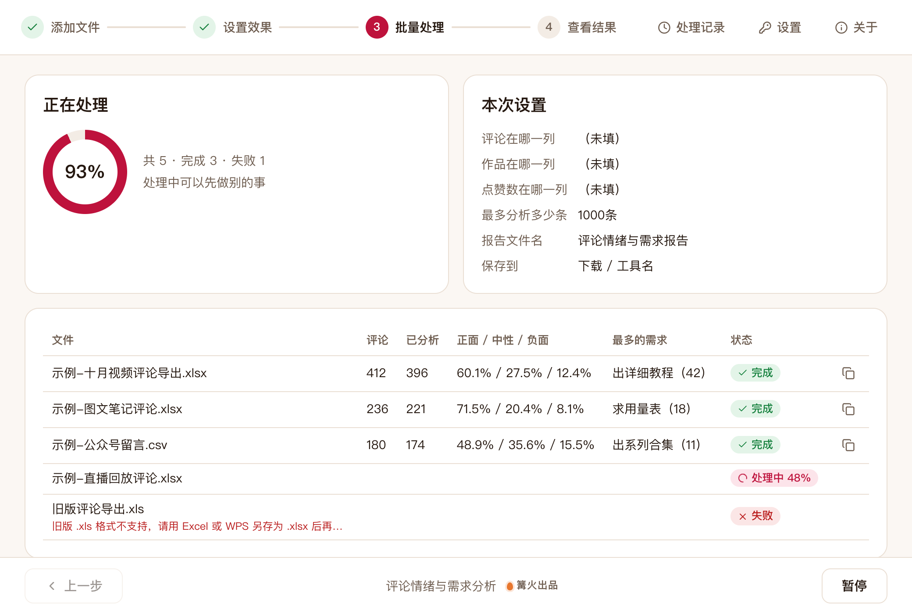

# 评论情绪与需求分析

> 篝火出品 · 收录于篝火 App 应用区

分析自有账号导出的评论数据：情绪分布、用户需求与建议、选题与运营建议。

> 本工具**只分析你自己从账号后台导出的评论表**，不登录任何平台、不抓取评论。评论内容会发送给你在「设置」里填写的大模型接口，请勿导入你无权处理的数据。



## 下载

到 [Releases](https://github.com/campfire-code/comment-insight/releases/latest) 下载对应安装包：

| 电脑 | 文件 |
|---|---|
| Windows 10 / 11 | `comment-insight_版本号_windows-x64-setup.exe` |
| Mac（Apple 芯片） | `comment-insight_版本号_mac-arm64.dmg` |
| Mac（Intel 芯片） | `comment-insight_版本号_mac-x64.dmg` |

第一次打开：
- **Windows**：如果弹出「Windows 已保护你的电脑」，点「更多信息」→「仍要运行」。
- **Mac**：如果提示「无法验证开发者」，打开「系统设置 → 隐私与安全性」，在下方点「仍要打开」。

## 怎么用

1. 先到「设置」填写自己的大模型接口地址、密钥和模型名（兼容 OpenAI 接口格式，例如 DeepSeek、通义千问）。密钥只保存在本机。
2. 从自己账号的创作者后台导出评论表（各平台导出入口和字段名不同，以平台为准；没有导出功能的，可以自己整理成表格）。支持 .xlsx 和 .csv；旧版 .xls 请先另存为 .xlsx。
3. 把一个或多个评论表拖进窗口。
4. 「评论在哪一列」不填会自动识别「评论内容」「留言」等表头；也可以填表头名或列字母（如 `C`）。有「作品标题」「点赞数」列时也会自动识别，没有就填「无」。
5. 点「开始处理」。每 30 条评论调用一次大模型，判断：
   - 情绪倾向：正面 / 中性 / 负面；
   - 细分情绪：喜爱、认同、感谢、期待、好奇、平淡、疑惑、失望、不满、愤怒；
   - 需求类型：内容需求（想看什么）、产品需求（想买什么）、改进建议、提问求助，没有就记「无」；
   - 需求要点：用一句短语概括，相同的需求会合并计数。
6. 全部处理完自动再调用 1 次大模型生成选题与运营建议，并导出 Excel 报告（多个文件合并成一份）：
   - 汇总：情绪占比、细分情绪、需求类型、运营建议；
   - 高频需求：前 20 个需求，按提到次数排序，次数相同按点赞合计排序，附点赞最多的一条评论；
   - 按作品：每个作品的正面 / 中性 / 负面条数和负面占比（表里有作品列时才有）；
   - 明细：每条评论的分析结果，负面评论标红。

**其他说明**
- 空评论、纯表情（如 `[赞]`、👍）不分析，计入「跳过」。
- 「最多分析多少条」用来控制费用，超出的部分不分析。
- 大模型偶尔漏掉某条时会自动补问一次；仍没有结果的记为中性并在明细里注明。
- AI 判断有误差，报告用于了解大致情况，重要结论请抽查明细。

## 验收用例

以下用例需要先在「设置」里配置可用的大模型。情绪和需求的具体数值由大模型判断，每次可能略有不同；下表只列确定的结果。

| 操作 | 应得到 |
|---|---|
| 拖入 `samples/示例-评论导出.xlsx`，参数保持默认，点「开始处理」 | 列表显示「评论 60、已分析 54」（6 条纯表情被跳过），调用大模型 2 次；处理完生成 `示例-评论导出-评论情绪与需求报告.xlsx`，提示「共分析 54 条评论，调用大模型 3 次（含 1 次生成运营建议）」 |
| 打开上一步的报告 | 有「汇总」「高频需求」「按作品」「明细」4 张表；「按作品」有 3 个示例作品；「明细」54 行，列为 行号、作品、评论内容、点赞、情绪倾向、细分情绪、需求类型、需求要点，负面评论的情绪单元格标红；「汇总」里跳过数为 6 |
| 同时拖入 `samples/示例-评论导出.xlsx` 和 `samples/示例-留言-无作品列.csv`，开始处理 | 只生成一份 `评论情绪与需求报告.xlsx`，「明细」第一列是「来源文件」，共 59 行数据（54 + 5） |
| 只拖入 CSV，「作品在哪一列」填 `视频` | 列表显示失败，原因是「找不到作品列「视频」，表头是：留言内容、时间」 |
| 没有配置大模型时开始处理 | 列表显示失败，提示「还没有设置大模型：请到「设置」里填写接口地址、密钥和模型名」 |

## 自己编译

需要 Node.js 22、pnpm、Rust。

```bash
pnpm install
pnpm test          # 单元测试
pnpm tauri dev     # 开发运行
pnpm tauri build   # 打包
```

界面框架在 `src/kit`（所有 campfire-code 工具共用），本工具的逻辑在 `src/tool`。

## 归属

本工具由**篝火**出品，是篝火 App 应用区收录的开源工具之一，由篝火（GitHub 组织 [campfire-code](https://github.com/campfire-code)）维护与更新。全部工具的目录见 [toolkit-hub](https://github.com/campfire-code/toolkit-hub)。

## 许可证

MIT，版权方为篝火（campfire-code）。
